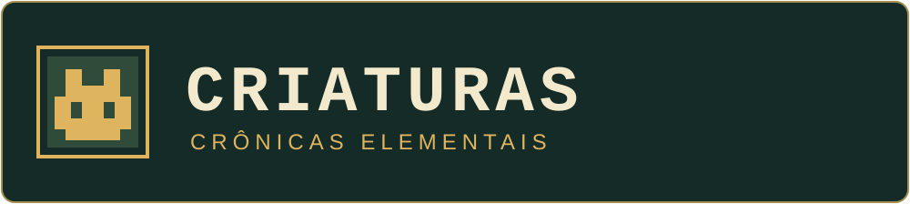
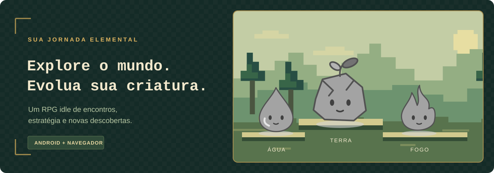
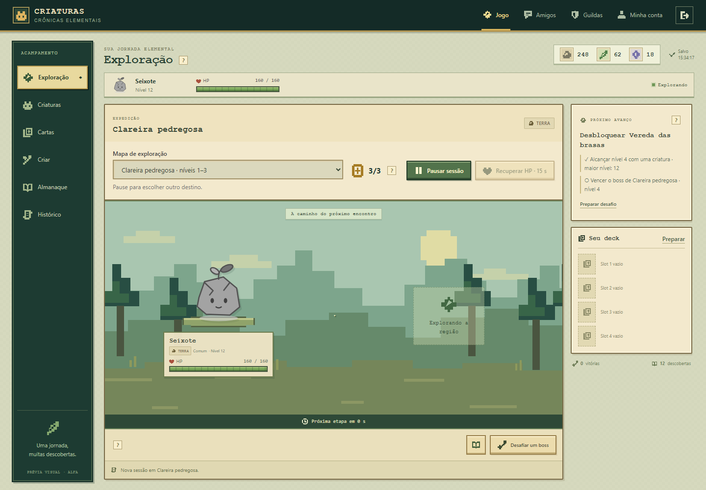
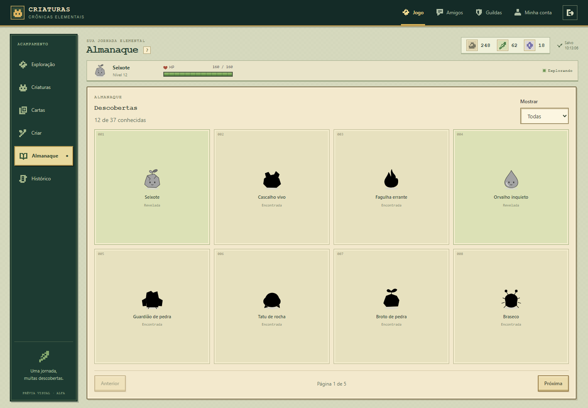
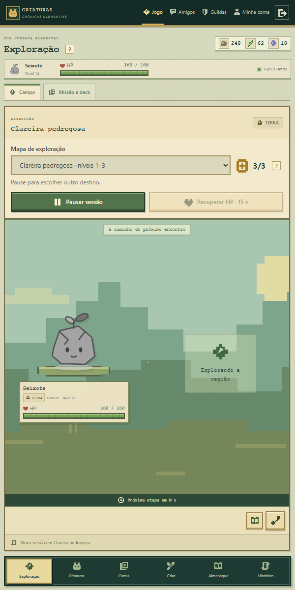
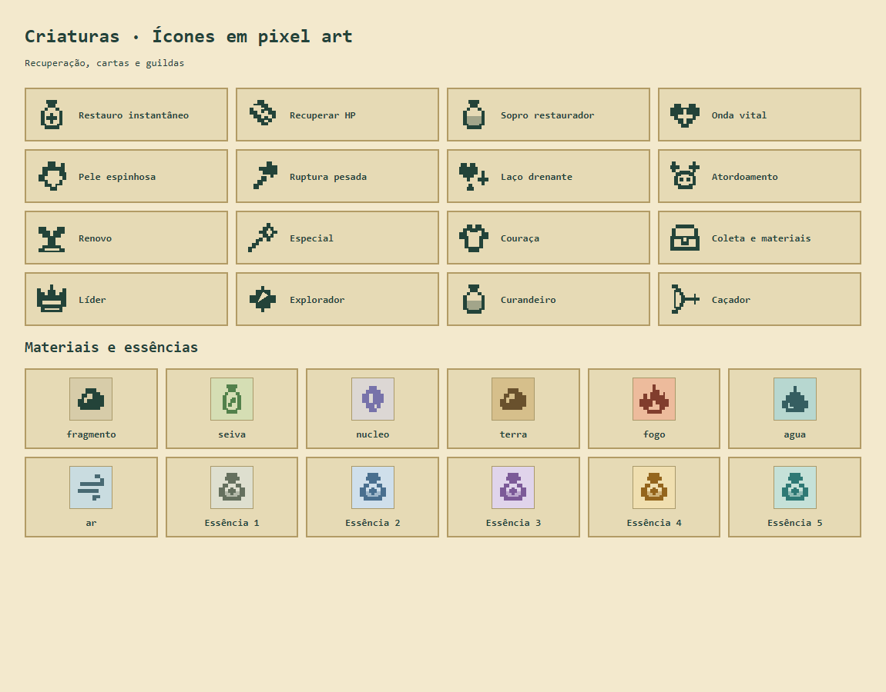

  

  <strong>Uma jornada elemental, uma descoberta de cada vez.</strong> 
  Explore regiões, desenvolva suas criaturas e construa sua coleção em um RPG idle para Android e navegador.

  
  
  
  

  <a href="#comece-sua-jornada">Baixar e jogar</a> ·
  <a href="#um-mundo-para-descobrir">O jogo</a> ·
  <a href="#por-dentro-do-jogo">Imagens</a> ·
  <a href="https://github.com/Naremancil/online-game-releases/releases">Histórico de versões</a>

  

## Comece sua jornada

| Onde jogar | Acesso | Requisitos |
| :--- | :--- | :--- |
| **Android** | **[Baixar o APK mais recente](https://github.com/Naremancil/online-game-releases/releases/latest)** | Android 7 ou superior · APK universal |
| **Navegador** | **[Abrir o jogo](https://raspberrypi.tail932f26.ts.net/)** | Celular ou computador com internet |

> **Acesso à alfa:** sua conta precisa ser aprovada pela administração para entrar no jogo. O APK e o navegador usam a mesma conta e o mesmo progresso.

### Instalar no Android

1. Abra a [última versão](https://github.com/Naremancil/online-game-releases/releases/latest) e baixe o arquivo **Jogo-Idle-….apk**.
2. Abra o arquivo baixado e, se solicitado, permita a instalação de aplicativos por esse navegador ou gerenciador de arquivos.
3. Instale e abra **Jogo Idle**, o nome exibido atualmente no celular.
4. Entre com sua conta aprovada. Em **Atualizações do aplicativo**, autorize o aplicativo a instalar as próximas versões.

Nas próximas instalações, use o APK deste repositório sobre a versão já instalada. Não é necessário desinstalar o aplicativo.

## Um mundo para descobrir

Escolha sua criatura, prepare o deck e decida para onde explorar. Os encontros acontecem automaticamente; suas escolhas de preparação orientam o desenvolvimento da jornada.

| Sistema | O que você encontra |
| :--- | :--- |
| **Exploração** | Regiões elementais, encontros automáticos e desafios contra bosses para abrir novos caminhos. |
| **Criaturas** | Níveis, características individuais, treinamento, invocações e evoluções. |
| **Cartas e criação** | Cartas com fundos elementais e receitas de acordo com sua função, além de essências de boss e aprimoramento até cinco estrelas por cópia. |
| **Almanaque** | Espécies reveladas conforme você encontra e desenvolve suas criaturas. |
| **Amigos e guildas** | Amigos, conversa privada e guildas de seis jogadores com quatro cargos e criaturas de apoio. |
| **Recuperação** | Três restauros instantâneos diários por conta e ajuda manual para sua criatura voltar à aventura. |
| **Progresso ao retornar** | O servidor calcula o avanço da exploração durante sua ausência, dentro dos limites do jogo. |

<strong>37 espécies · 19 cartas · 10 regiões</strong> Conteúdo atual da alfa, sujeito a evolução durante o desenvolvimento.

## Por dentro do jogo

**Exploração — prepare sua criatura e acompanhe a expedição.**

<table>
  <tr>
    <th width="68%">Almanaque e descobertas</th>
    <th width="32%">Interface em tela menor</th>
  </tr>
  <tr>
    <td valign="top"></td>
    <td valign="top"></td>
  </tr>
</table>

Capturas da interface real em uma conta de demonstração. O conteúdo pode mudar nas próximas versões.

**Ícones de recuperação, cartas, materiais e guildas.**

## Atualizações do aplicativo

Após a autorização inicial, o Android consulta novas versões **aproximadamente a cada hora** e tenta instalar a atualização disponível. O sistema pode pedir confirmação e ajustar o horário da verificação conforme as condições do aparelho.

Você também pode abrir **Atualizações do aplicativo** para verificar manualmente ou baixar o APK pela [página de versões](https://github.com/Naremancil/online-game-releases/releases).
Os avisos de encontros difíceis e chamados de aventura podem ser ativados em **Minha conta → Opções**.

## Dúvidas rápidas

**Posso alternar entre celular e computador?**

Sim. Entre com a mesma conta para acessar os dados mantidos no servidor.

**Preciso de internet?**

Sim, para entrar e sincronizar as ações. Ao retornar, o jogo calcula o progresso da exploração durante a ausência conforme as regras do servidor.

**Criei uma conta e ainda não consigo entrar.**

Nesta alfa, o acesso depende de aprovação manual da administração.

**Onde está o código do jogo?**

Este é o repositório público de distribuição: aqui ficam o APK, as informações de atualização e as imagens de apresentação. O código-fonte é mantido em um repositório privado.

---

   
  <strong>Criaturas — Crônicas Elementais</strong> 
  <a href="https://raspberrypi.tail932f26.ts.net/">Jogar no navegador</a> ·
  <a href="https://github.com/Naremancil/online-game-releases/releases/latest">Baixar para Android</a>

